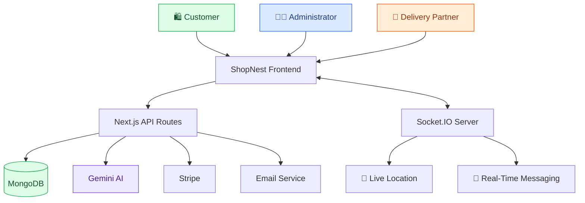

<div align="center">

# 🛒 ShopNest

### Smart Grocery Shopping & Delivery Platform

A full-stack grocery delivery platform featuring AI assistance, interactive maps, real-time delivery tracking, and online payments.

<br/>


\

</div>

---

## 🟢 About the Project

ShopNest is a full-stack grocery shopping and delivery platform designed to simplify online shopping and delivery management.

Customers can browse groceries, place orders, select delivery locations, and track deliveries. Administrators can manage products and orders, while delivery partners can access assigned deliveries and share their locations.

## ✨ Key Features

| Feature               | Description                                           |
| --------------------- | ----------------------------------------------------- |
| 🛍️ Grocery Shopping  | Browse products, manage cart items, and place orders. |
| 🤖 AI Assistant       | Gemini-powered conversational assistance.             |
| 🗺️ Interactive Maps  | Map-based location selection using Leaflet.           |
| 🚚 Live Tracking      | Real-time delivery location updates using Socket.IO.  |
| 👨‍💼 Admin Dashboard | Product and order management.                         |
| 🔐 Authentication     | Credentials-based authentication and Google sign-in.  |
| 💳 Payments           | Stripe integration.                                   |
| 📧 Email & OTP        | Email notifications and delivery verification.        |
| 💬 Live Messaging     | Real-time communication through Socket.IO.            |

---

## 🎨 Tech Stack

### Frontend


\

### Backend & Database


\

### AI, Maps & Integrations


\

### Supporting Tools


\

---

## 🏗️ System Architecture



---

## 🤖 AI, Maps & Real-Time Tracking

### 🔵 AI Integration

Google Gemini API powers the AI assistant and provides conversational assistance for grocery-related queries.

### 🟢 Interactive Maps

Leaflet and React Leaflet support map-based location selection and delivery location visualization.

### 🟠 Real-Time Delivery

Socket.IO enables real-time communication, location updates, and messaging between connected application components.

---

## 📁 Project Structure

```text
groceryFolder/
├── shopnest/
│   ├── public/
│   ├── src/
│   │   ├── app/
│   │   ├── components/
│   │   ├── lib/
│   │   ├── models/
│   │   └── hooks/
│   └── package.json
├── socketServer/
│   ├── index.js
│   └── package.json
└── README.md
```

*This is a simplified overview; the actual structure may differ.*

---

## ⚙️ Getting Started

### 🧩 Prerequisites

* Node.js and npm
* MongoDB database
* Git
* API credentials for the external services you use

### 1. Clone the Repository

```bash
git clone https://github.com/samarthpandey158/groceryFolder.git
cd groceryFolder
```

### 2. Install Frontend Dependencies

```bash
cd shopnest
npm install
```

### 3. Configure Environment Variables

Create a `.env.local` file inside the `shopnest` directory.

```env
MONGODB_URL=your_mongodb_connection_string

AUTH_SECRET=your_auth_secret

GOOGLE_CLIENT_ID=your_google_client_id
GOOGLE_CLIENT_SECRET=your_google_client_secret

GEMINI_API_KEY=your_gemini_api_key

STRIPE_SECRET_KEY=your_stripe_secret_key
STRIPE_WEBHOOK_SECRET=your_stripe_webhook_secret

EMAIL=your_email
PASS=your_email_app_password

CLOUDINARY_NAME=your_cloudinary_name
CLOUDINARY_API_KEY=your_cloudinary_api_key
CLOUDINARY_API_SECRET=your_cloudinary_api_secret

NEXT_BASE_URL=http://localhost:3000
NEXT_PUBLIC_SOCKET_SERVER=http://localhost:5000
```

Use the exact variable names expected by your source code. Configure the socket server separately if required. Never commit real credentials to GitHub.

### 4. Start the Frontend

```bash
npm run dev
```

Open `http://localhost:3000` in your browser.

### 5. Start the Socket Server

In a separate terminal:

```bash
cd socketServer
npm install
npm run dev
```

Use the appropriate start command from the socket server's `package.json` if its scripts differ.

---

## 🔒 Security Considerations

* 🔐 Store credentials in environment variables.
* 🛡️ Validate requests on the server.
* 🔑 Hash passwords before storing them.
* 👥 Protect administrative routes with authorization.
* 💳 Verify payment webhook signatures.
* 🚫 Keep `.env` and `.env.local` out of version control.

## 💡 Skills Demonstrated

* Full-stack web development.
* API development and database integration.
* Authentication and authorization.
* Generative AI integration.
* Geolocation and interactive maps.
* Real-time communication with Socket.IO.
* Payment and email integrations.
* Role-based application workflows.
* Deployment and environment configuration.

---

## 👨‍💻 Author

**Samarth Pandey**
Computer Science and Engineering Student 

GitHub Profile: [samarthpandey158](https://github.com/samarthpandey158)

---

## 🚀 Live Demo

Explore the deployed application:

<div align="center">

### [🛒 Open ShopNest](https://shopnest-brown.vercel.app)

</div>

*AI, payment, email, and real-time tracking features depend on the availability and configuration of their respective services.*

<div align="center">

**ShopNest — Built with modern web technologies.**

</div>
