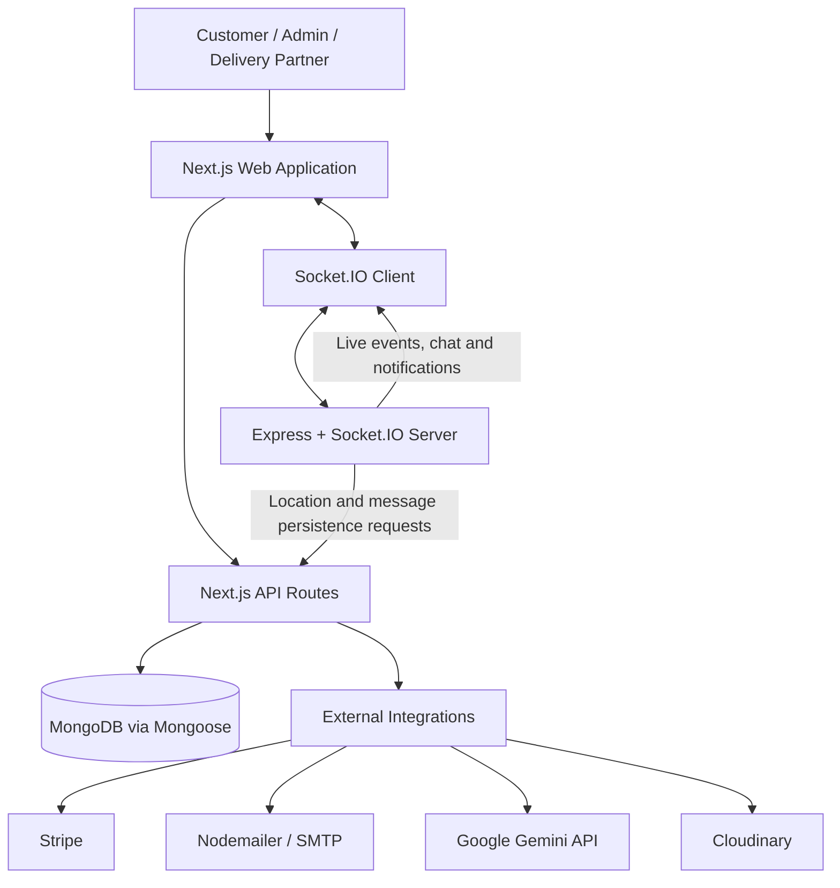

<div align="center">

# 🛒 ShopNest — Grocery Shopping & Delivery Platform

**A full-stack grocery delivery application with customer shopping, admin operations, delivery-partner workflows, real-time tracking, and order communication.**

[](https://nextjs.org/)
[](https://react.dev/)
[](https://www.typescriptlang.org/)
[](https://www.mongodb.com/)
[](https://socket.io/)

</div>

---

## 📌 Overview

ShopNest is a full-stack grocery shopping and delivery platform built with **Next.js, React, TypeScript, MongoDB, and Socket.IO**. Its standout features are **map-based delivery tracking, real-time order chat, AI-powered chat suggestions, and OTP-verified delivery completion**. It brings together three role-based experiences in one application:

- **Customers** can browse grocery products, manage their cart, place orders, choose a payment method, view order history, and track delivery.
- **Administrators** can manage grocery inventory, manage orders, allocate available delivery partners, and view dashboard summaries.
- **Delivery partners** can view assignments, share their location, communicate about an order, and complete a delivery using an email OTP verification workflow.

A separate **Express + Socket.IO service** handles real-time events such as location updates, order-room messaging, and notifications. MongoDB with Mongoose stores application data.

> **Project note:** The supplied source code/package is named **ShopNest** in several places. If you want the portfolio project to be branded as **SnapCart**, make the README title, application branding, repository description, and deployed website name consistent. Add your live demo URL and real application screenshots before sharing this README with recruiters.

## ✨ Features

> **Key differentiators:** map-based delivery tracking, real-time order communication, Gemini-powered AI chat suggestions, Stripe checkout, and OTP-verified delivery completion.

### 🛍️ Customer experience
- Account registration and sign-in.
- Google sign-in and credentials-based authentication.
- Browse grocery products and categories.
- Add products to the cart and proceed to checkout.
- Choose **Cash on Delivery (COD)** or the online Stripe checkout flow, where configured.
- Provide a delivery address and location coordinates.
- View previous orders and check order status.
- Track delivery-partner location on a map.
- Communicate in the order chat when the order workflow makes it available.
- Receive email-based delivery OTPs and confirm delivery completion.

### 🧑‍💼 Admin dashboard
- Admin-facing sign-in and dashboard.
- Add, view, edit, and delete grocery products.
- View and manage customer orders.
- Allocate orders to delivery partners through the delivery-assignment workflow.
- Trigger order-status updates and notifications.
- Review dashboard revenue summaries, including today, recent-period, and overall totals where supported by the current dashboard implementation.

### 🛵 Delivery-partner experience
- Delivery-partner account and dashboard.
- View delivery assignments and accept an assignment.
- View current delivery/order information.
- Share location updates for map-based tracking.
- Communicate through order-specific chat.
- Generate and email a delivery OTP to the customer.
- Complete delivery after OTP verification.
- View delivery and earnings summaries where provided by the dashboard.

### 🗺️ Live maps, real-time chat, and AI
- **Address selection on a map:** customers can select or adjust delivery coordinates during checkout.
- **Live delivery tracking:** the customer can view delivery-partner location updates on a map; the application uses Leaflet and React Leaflet for map UI.
- **Real-time order chat:** the customer and delivery partner can communicate through an order-specific chat room, with messages persisted through a Next.js API route and real-time events delivered by Socket.IO.
- **AI chat assistance:** the project includes a Google Gemini-powered API route for generating chat suggestions. The AI suggestion feature is distinct from the Socket.IO chat transport.
- **Live status and notifications:** the separate Express + Socket.IO server relays events for relevant order and delivery workflows.
- **Email OTP:** Nodemailer is used to email a delivery-verification OTP to the customer.
- **Online payments:** Stripe integration supports the online payment workflow, alongside COD.
- **Product media:** Cloudinary utility supports image handling/upload.

### 🔌 Other integrations
- **Email:** Nodemailer with SMTP configuration.
- **Payments:** Stripe.
- **AI:** Google Gemini API (`@google/genai`).
- **Media:** Cloudinary.

**Integration status:** Some features depend on valid external credentials and correct deployment configuration. Test each flow end-to-end before describing it as production-ready.

## 🧰 Technology Stack

| Area | Technologies |
|---|---|
| Web framework | Next.js App Router |
| UI | React, TypeScript |
| Styling | Tailwind CSS |
| Authentication | NextAuth, Credentials provider, Google provider |
| Password hashing | bcrypt |
| Client state | Redux Toolkit, React Redux |
| Database | MongoDB |
| ODM / data models | Mongoose |
| Real-time communication | Socket.IO client, Socket.IO |
| Socket service | Node.js, Express |
| Maps and geolocation | Leaflet, React Leaflet, Leaflet GeoSearch |
| HTTP requests | Axios |
| Email | Nodemailer, Gmail SMTP |
| Payments | Stripe |
| AI integration | Google Gemini API (`@google/genai`) |
| Media uploads | Cloudinary |
| Icons and animation | Lucide React, React Icons, Motion |
| Charts | Recharts |
| Linting | ESLint |

## 🏗️ Application Architecture

The repository contains two separately run applications: the Next.js web app and a standalone Socket.IO server.



### Main responsibilities
- **Next.js application:** UI, authentication, API route handlers, order workflows, and database operations.
- **MongoDB + Mongoose:** Users, groceries, orders, delivery assignments, and chat messages.
- **Socket.IO service:** Persistent socket connections, order rooms, location broadcasts, and notification events.
- **External services:** Stripe checkout, SMTP email, Gemini AI suggestions, and Cloudinary uploads.

## 📂 Repository Structure

```text
groceryFolder/
├── shopnest/                         # Next.js web application
│   ├── src/
│   │   ├── app/                      # Pages and API route handlers
│   │   │   ├── admin/                # Admin pages
│   │   │   ├── user/                 # Cart, checkout, orders and tracking
│   │   │   └── api/                  # Authentication and application APIs
│   │   ├── components/               # Customer, admin, delivery, map and chat UI
│   │   ├── lib/                      # Database, mail, Cloudinary and socket utilities
│   │   ├── models/                   # Mongoose models
│   │   └── redux/                    # Redux store and slices
│   ├── public/                       # Static assets
│   ├── package.json
│   └── next.config.ts
├── socketServer/                     # Express + Socket.IO service
│   ├── index.js
│   └── package.json
└── README.md
```

## 🚀 Getting Started

### Prerequisites
- Node.js and npm compatible with the versions required by the project dependencies.
- A MongoDB database (local or hosted).
- Google OAuth credentials if Google sign-in is to be used.
- SMTP credentials / a Gmail App Password if email sending is to be used.
- Stripe API credentials for online checkout.
- Gemini API key for AI suggestions.
- Cloudinary credentials if image uploads are used.

### 1. Clone the repository

```bash
git clone https://github.com/samarthpandey158/groceryFolder.git
cd groceryFolder
```

### 2. Install the Next.js application dependencies

```bash
cd shopnest
npm install
```

Create `shopnest/.env.local` and add the environment variables listed below.

### 3. Install the Socket.IO service dependencies

Open a **second terminal** from the repository root:

```bash
cd socketServer
npm install
```

Create `socketServer/.env` and configure its variables.

### 4. Start both applications

**Terminal 1 — Next.js web app**

```bash
cd shopnest
npm run dev
```

The app normally runs at [http://localhost:3000](http://localhost:3000).

**Terminal 2 — Socket.IO server**

```bash
cd socketServer
npm run dev
```

The socket service defaults to port `5000`. Keep both processes running while testing real-time features.

## 🔐 Environment Configuration

Create environment files locally. **Never commit real secrets, passwords, tokens, database URLs, or API keys.** The variable names below are based on references in the supplied source code; check the current code before changing names.

### `shopnest/.env.local`

```env
# MongoDB
MONGODB_URL=

# NextAuth
AUTH_SECRET=

# Google OAuth (optional if Google sign-in is enabled)
GOOGLE_CLIENT_ID=
GOOGLE_CLIENT_SECRET=

# Public Socket.IO server URL
NEXT_PUBLIC_SOCKET_SERVER=http://localhost:5000

# Gmail SMTP / Nodemailer
EMAIL=
PASS=

# Stripe
STRIPE_SECRET_KEY=
STRIPE_WEBHOOK_SECRET=

# Cloudinary image uploads
CLOUDINARY_NAME=
CLOUDINARY_API_KEY=
CLOUDINARY_API_SECERT=

# Google Gemini AI
GEMINI_API_KEY=

# Base URL used by the payment flow
NEXT_BASE_URL=http://localhost:3000
```

### `socketServer/.env`

```env
PORT=5000
NEXT_BASE_URL=http://localhost:3000
```

### Environment-variable notes
- `MONGODB_URL` is the MongoDB connection string.
- `AUTH_SECRET` is the NextAuth secret.
- `GOOGLE_CLIENT_ID` and `GOOGLE_CLIENT_SECRET` are for Google OAuth.
- `NEXT_PUBLIC_SOCKET_SERVER` is the browser-facing Socket.IO server URL.
- `EMAIL` and `PASS` are used by Nodemailer. For Gmail, use an App Password where required; do not use your normal account password.
- `STRIPE_SECRET_KEY` and `STRIPE_WEBHOOK_SECRET` are used by the payment integration and webhook flow.
- `CLOUDINARY_NAME`, `CLOUDINARY_API_KEY`, and `CLOUDINARY_API_SECERT` are used by the current Cloudinary utility. **The source currently spells `SECRET` as `SECERT`; keep the variable name aligned with the source until you correct the spelling in the code.**
- `GEMINI_API_KEY` is used by the Gemini integration.
- `NEXT_BASE_URL` is used to construct application URLs. Configure it for the deployed web-app URL in production.

For production, set environment variables in each hosting provider's dashboard. Update `NEXT_PUBLIC_SOCKET_SERVER` to the deployed socket URL, set `NEXT_BASE_URL` to the deployed web-app URL, and restrict Socket.IO CORS to the expected frontend origin.

## 🧾 Main Data Models

| Model | Purpose |
|---|---|
| `User` | Account details, role, profile, online/socket information, and location |
| `Grocery` | Grocery product information, category, price, unit, and image |
| `Order` | Customer, items, amount, address, payment method, status, and delivery OTP data |
| `DeliveryAssignment` | Order assignment and delivery-partner workflow |
| `Message` | Order-room chat messages |

The user model includes a GeoJSON-style location field, and the application uses location coordinates for delivery tracking.

## 🔄 Example Order Workflow

1. A customer signs in, selects groceries, and checks out.
2. The customer chooses COD or proceeds through the configured Stripe checkout flow.
3. The order is stored and becomes available to the admin workflow.
4. The admin manages the order and assigns an available delivery partner.
5. The delivery partner receives assignment/status updates and can share their location.
6. The customer can view order progress and map-based location updates; the relevant participants can communicate through the order chat where enabled.
7. When the delivery partner is ready to complete the delivery, the application generates an OTP and emails it to the customer.
8. The customer provides the OTP for verification. On successful verification, the order status is changed to `Delivered` and a status event is emitted.

Actual notification delivery and payment completion depend on correct credentials, webhook configuration, authorization, and deployment settings.

## 🖥️ Application Screenshots

These screenshots show the current ShopNest UI for customer access, grocery shopping, and administration/delivery-partner dashboards.

<table>
  <tr>
    <td width="50%"><strong>Customer Homepage</strong><br></td>
    <td width="50%"><strong>Grocery Catalogue</strong><br></td>
  </tr>
  <tr>
    <td width="50%"><strong>Customer Sign In</strong><br></td>
    <td width="50%"><strong>Customer Registration</strong><br></td>
  </tr>
  <tr>
    <td width="50%"><strong>Admin Dashboard</strong><br></td>
    <td width="50%"><strong>Manage Groceries</strong><br></td>
  </tr>
  <tr>
    <td width="50%"><strong>Add Grocery</strong><br></td>
    <td width="50%"><strong>Delivery Partner Dashboard</strong><br></td>
  </tr>
</table>

> **Visuals still to add:** Add clean screenshots of live map tracking, the AI-chat interface, order chat, checkout/payment selection, and OTP verification. The OTP screenshot supplied included browser developer-console errors, so it has intentionally been left out of this public-facing gallery.


## 🧪 Available Scripts

### Next.js app (`shopnest`)

| Command | Purpose |
|---|---|
| `npm run dev` | Start the development server |
| `npm run build` | Build the app for production |
| `npm run start` | Start the production server |
| `npm run lint` | Run ESLint |

### Socket service (`socketServer`)

| Command | Purpose |
|---|---|
| `npm run dev` | Run `index.js` with Nodemon |

## 🔒 Security and Deployment Checklist

Before using this as a public portfolio project, review these items carefully:

- [ ] Confirm `.env`, `.env.local`, and all credentials are ignored by Git.
- [ ] Rotate any secret that was ever committed to a public repository.
- [ ] Enforce server-side authentication and role-based authorization on admin and delivery APIs.
- [ ] Validate request bodies and socket-event payloads.
- [ ] Verify that users can access only their own orders and permitted chat rooms.
- [ ] Authenticate and authorize the Socket.IO notification endpoint before exposing it publicly.
- [ ] Verify online payments through trusted Stripe server/webhook events rather than trusting client-side status.
- [ ] Restrict Socket.IO CORS to the intended frontend origin.
- [ ] Test registration, sign-in, checkout, assignment, live tracking, chat, email OTP, and OTP verification end-to-end.
- [ ] Run `npm run lint` and `npm run build` and fix any errors before deployment.

### Deployment outline
1. Deploy the `shopnest` Next.js application to a Next.js-compatible host.
2. Deploy `socketServer` separately to a host that supports persistent WebSocket connections.
3. Set each service's environment variables in its hosting dashboard.
4. Configure the frontend's Socket.IO URL and the socket server's allowed frontend origin.
5. Configure OAuth callback URLs, Stripe webhook settings, SMTP, Gemini, and Cloudinary as needed.
6. Test the deployed application using non-sensitive test accounts and test payment flows.

## 🗺️ Roadmap

Potential improvements for a stronger production-quality portfolio:

- [ ] Add automated unit and integration tests for authentication, checkout, order updates, and delivery OTP verification.
- [ ] Add CI checks for linting, tests, and production builds.
- [ ] Document API contracts, request payloads, responses, and authorization requirements.
- [ ] Add rate limiting and stronger validation for sensitive APIs and socket events.
- [ ] Add structured logging and production error monitoring.
- [ ] Improve accessibility, loading states, empty states, and error states.
- [ ] Add pagination and robust product search/filtering for larger catalogues.
- [ ] Add a short project demo video and a complete screenshot gallery.

## 👨‍💻 Author

**Samarth Pandey**  
B.Tech — Computer Science & Engineering

- GitHub: [@samarthpandey158](https://github.com/samarthpandey158)
- LinkedIn: **Add your LinkedIn profile URL**

---

<div align="center">

Built as a full-stack portfolio project to explore grocery commerce, role-based workflows, payment integration, and real-time delivery experiences.

</div>
