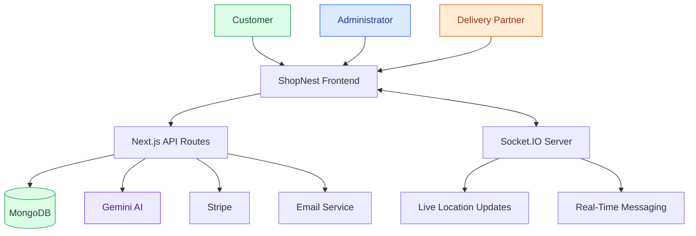

<div align="center">


# 🛒 ShopNest

### **Smart Grocery Shopping & Delivery Platform**

Shop smarter. Track faster. Deliver better.

A full-stack grocery delivery platform featuring AI-powered assistance, interactive maps, real-time delivery tracking, and online payments.


</div>

---

## 🟢 About the Project

**ShopNest** is a full-stack grocery shopping and delivery platform designed to simplify online shopping and delivery management.

Customers can browse groceries, add products to their cart, place orders, select delivery locations, and follow delivery progress. Administrators can manage products and orders, while delivery partners can access assigned deliveries and share their locations.

The project combines modern web technologies with AI integration, interactive maps, and real-time communication.

## ✨ Key Features

| Feature | Description |
|---|---|
| 🛍️ **Grocery Shopping** | Browse products, manage cart items, and place orders. |
| 🤖 **AI Assistant** | Gemini-powered conversational assistance. |
| 🗺️ **Interactive Maps** | Map-based location selection using Leaflet. |
| 🚚 **Live Tracking** | Real-time delivery location updates using Socket.IO. |
| 👨‍💼 **Admin Dashboard** | Product and order management. |
| 🔐 **Authentication** | Credentials-based authentication and Google sign-in. |
| 💳 **Payments** | Stripe payment integration. |
| 📧 **Email & OTP** | Email notifications and delivery verification. |
| 💬 **Live Messaging** | Real-time communication through Socket.IO. |

---

## 🎨 Tech Stack

### Frontend


### Backend & Database


### AI, Maps & Integrations


### Supporting Tools


| Technology | Role in ShopNest |
|---|---|
| Next.js & React | Application pages, routing, and UI components |
| TypeScript | Type-safe application development |
| Tailwind CSS | Responsive styling |
| Node.js & Express.js | Server-side runtime and socket server |
| MongoDB & Mongoose | Data storage, schemas, and database operations |
| Socket.IO | Real-time location updates and messaging |
| Redux Toolkit | Shared frontend state |
| Google Gemini API | AI-powered conversational assistance |
| Leaflet & React Leaflet | Interactive maps and location visualization |
| NextAuth.js & Google OAuth | Authentication workflows |
| bcrypt | Password hashing |
| Stripe | Payment integration |
| Nodemailer | Email notifications and OTP delivery |
| Cloudinary | Media storage |
| Axios | HTTP requests |

---

## 🏗️ System Architecture



---

## 🤖 AI, Maps & Real-Time Tracking

### 🤖 AI Integration

The Google Gemini API powers the AI assistant, providing a conversational interface for grocery-related queries and assistance.

### 🗺️ Interactive Maps

Leaflet and React Leaflet support map-based location selection and delivery location visualization.

### 🚚 Real-Time Delivery

Socket.IO enables real-time communication between application components, supporting location updates and messaging.

> Real-time tracking depends on the socket server being available and correctly configured. Location accuracy depends on the device and location permissions.

---

## 📁 Project Structure

```text
groceryFolder/
├── shopnest/
│   ├── public/
│   ├── src/
│   │   ├── app/
│   │   │   └── api/
│   │   ├── components/
│   │   ├── lib/
│   │   ├── models/
│   │   └── hooks/
│   └── package.json
├── socketServer/
│   ├── index.js
│   └── package.json
└── README.md
```

*This is a high-level overview. Use the actual repository structure if folder names differ.*

---

## ⚙️ Getting Started

### Prerequisites

- Node.js and npm
- A MongoDB database
- Git
- API credentials for the external services you use

### 1. Clone the Repository

```bash
git clone https://github.com/samarthpandey158/groceryFolder.git
cd groceryFolder
```

### 2. Install Frontend Dependencies

```bash
cd shopnest
npm install
```

### 3. Configure Environment Variables

Create a `.env.local` file inside `shopnest`. Add the variables required by your source code.

```env
MONGODB_URL=your_mongodb_connection_string

AUTH_SECRET=your_auth_secret

GOOGLE_CLIENT_ID=your_google_client_id
GOOGLE_CLIENT_SECRET=your_google_client_secret

GEMINI_API_KEY=your_gemini_api_key

STRIPE_SECRET_KEY=your_stripe_secret_key
STRIPE_WEBHOOK_SECRET=your_stripe_webhook_secret

EMAIL=your_email
PASS=your_email_app_password

CLOUDINARY_NAME=your_cloudinary_name
CLOUDINARY_API_KEY=your_cloudinary_api_key
CLOUDINARY_API_SECRET=your_cloudinary_api_secret

NEXT_BASE_URL=http://localhost:3000
NEXT_PUBLIC_SOCKET_SERVER=http://localhost:5000
```

**Important:**
- Use the exact environment variable names referenced by your source code.
- Configure the socket server's environment variables separately if required.
- Some variables are only needed when using their associated integrations.
- Never commit real API keys, passwords, or database credentials to GitHub.

### 4. Start the Frontend

From the `shopnest` directory:

```bash
npm run dev
```

Open `http://localhost:3000` in your browser.

### 5. Start the Socket Server

Open a separate terminal from the repository root:

```bash
cd socketServer
npm install
npm run dev
```

Use the start command defined in `socketServer/package.json` if its scripts differ. Ensure the frontend socket URL points to the running socket server.

---

## 🔒 Security Considerations

- Store credentials in environment variables.
- Never expose private API keys through `NEXT_PUBLIC_` variables.
- Validate requests and authorize access on the server.
- Hash passwords before storing them.
- Protect administrator and delivery-partner routes with authorization checks.
- Verify payment webhook signatures.
- Keep `.env` and `.env.local` out of version control.

## 💡 Skills Demonstrated

- Full-stack web application development.
- API development and database integration.
- Authentication and authorization.
- Generative AI API integration.
- Geolocation and interactive maps.
- Real-time communication using Socket.IO.
- Payment and email service integration.
- Role-based application workflows.
- Deployment and environment configuration.

---

## 👨‍💻 Author

**Samarth Pandey**  
Computer Science and Engineering Student

---

## 🚀 Live Demo

Explore the deployed application:

<div align="center">

<a href="https://shopnest-india.vercel.app">
  
</a>

<br/>

**[ShopNest — Live Application](https://shopnest-brown.vercel.app)**

</div>

*AI, payment, email, and real-time tracking features depend on the configuration and availability of their respective services.*

<div align="center">

**ShopNest — Built with modern web technologies.**

</div>
