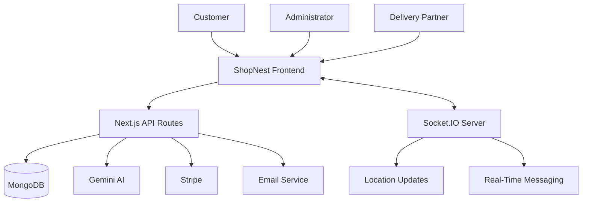

<div align="center">

# ShopNest

### Smart Grocery Shopping & Delivery Platform

A full-stack grocery delivery application featuring AI-powered assistance, interactive maps, real-time delivery tracking, and online payments.

</div>

---

## About the Project

ShopNest is a full-stack grocery shopping and delivery platform designed to simplify online shopping and delivery management.

Customers can browse groceries, add products to their cart, place orders, select delivery locations, and track deliveries. Administrators can manage products and orders, while delivery partners can access assigned deliveries and share their locations.

## Key Features

* **Grocery Shopping:** Browse products, manage cart items, place orders, and view order status.
* **AI Shopping Assistant:** Gemini API integration for conversational assistance and grocery-related queries.
* **Interactive Maps:** Leaflet-based maps and location selection.
* **Real-Time Delivery Tracking:** Socket.IO-based location updates and delivery communication.
* **Admin Dashboard:** Product and order management.
* **Authentication:** Credentials-based authentication and Google sign-in.
* **Payments:** Stripe integration.
* **Email Notifications:** Email notifications and delivery OTP functionality.
* **Real-Time Messaging:** Socket.IO-based room communication.

---

## Tech Stack

| Technology                 | Purpose                                        |
| -------------------------- | ---------------------------------------------- |
| Next.js                    | Application framework, routing, and API routes |
| React                      | Component-based user interface                 |
| TypeScript                 | Type-safe development                          |
| Tailwind CSS               | Responsive styling                             |
| Node.js                    | Server-side JavaScript runtime                 |
| Express.js                 | Separate real-time server                      |
| Socket.IO                  | Real-time messaging and location updates       |
| MongoDB                    | Database                                       |
| Mongoose                   | MongoDB schemas and database operations        |
| NextAuth.js                | Authentication workflows                       |
| Google OAuth               | Google sign-in                                 |
| bcrypt                     | Password hashing                               |
| Redux Toolkit              | Frontend state management                      |
| Google Gemini API          | AI-powered assistance                          |
| Leaflet                    | Interactive maps                               |
| React Leaflet              | React integration for Leaflet                  |
| Stripe                     | Payment processing                             |
| Nodemailer                 | Email and OTP delivery                         |
| Cloudinary                 | Media storage                                  |
| Axios                      | HTTP requests                                  |
| Lucide React / React Icons | Interface icons                                |

---

## System Architecture



## AI, Maps & Real-Time Tracking

### AI Integration

Google Gemini API provides conversational assistance for grocery-related queries.

### Interactive Maps

Leaflet and React Leaflet support map-based location selection and delivery location visualization.

### Real-Time Tracking

Socket.IO enables real-time communication, including location updates and messaging between connected application components.

---

## Project Structure

```text
groceryFolder/
├── shopnest/
│   ├── public/
│   ├── src/
│   │   ├── app/
│   │   ├── components/
│   │   ├── lib/
│   │   ├── models/
│   │   └── hooks/
│   └── package.json
├── socketServer/
│   ├── index.js
│   └── package.json
└── README.md
```

*This is a simplified overview. Refer to the actual repository for the complete structure.*

---

## Getting Started

### Prerequisites

* Node.js and npm
* MongoDB database
* Git
* API credentials for the external services you use

### 1. Clone the Repository

```bash
git clone https://github.com/samarthpandey158/groceryFolder.git
cd groceryFolder
```

### 2. Install Frontend Dependencies

```bash
cd shopnest
npm install
```

### 3. Configure Environment Variables

Create a `.env.local` file inside the `shopnest` directory.

```env
MONGODB_URL=your_mongodb_connection_string

AUTH_SECRET=your_auth_secret

GOOGLE_CLIENT_ID=your_google_client_id
GOOGLE_CLIENT_SECRET=your_google_client_secret

GEMINI_API_KEY=your_gemini_api_key

STRIPE_SECRET_KEY=your_stripe_secret_key
STRIPE_WEBHOOK_SECRET=your_stripe_webhook_secret

EMAIL=your_email
PASS=your_email_app_password

CLOUDINARY_NAME=your_cloudinary_name
CLOUDINARY_API_KEY=your_cloudinary_api_key
CLOUDINARY_API_SECRET=your_cloudinary_api_secret

NEXT_BASE_URL=http://localhost:3000
NEXT_PUBLIC_SOCKET_SERVER=http://localhost:5000
```

Use the exact environment variable names expected by your source code. Configure the socket server separately if required.

**Security:** Never commit real API keys, passwords, or database credentials to GitHub.

### 4. Run the Frontend

From the `shopnest` directory:

```bash
npm run dev
```

Open `http://localhost:3000`.

### 5. Run the Socket Server

Open a separate terminal:

```bash
cd socketServer
npm install
npm run dev
```

Use the start command defined in the socket server's `package.json` if its scripts differ.

---

## Security Considerations

* Store credentials in environment variables.
* Never expose private API keys through public environment variables.
* Validate requests on the server.
* Hash passwords before storing them.
* Protect administrative routes with authorization.
* Verify payment webhook signatures.
* Keep `.env` and `.env.local` out of version control.

## Skills Demonstrated

* Full-stack web development.
* API development and database integration.
* Authentication and authorization.
* Generative AI API integration.
* Interactive maps and geolocation.
* Real-time communication with Socket.IO.
* Payment and email service integration.
* Role-based application workflows.
* Deployment and environment configuration.

---

## Author

**Samarth Pandey**


GitHub Profile: [samarthpandey158](https://github.com/samarthpandey158)

---

## Live Demo

Explore the deployed application:

**[Open ShopNest Live Demo](https://shopnest-brown.vercel.app)**

*AI, payment, email, and real-time tracking features depend on the availability and configuration of their respective services.*

<div align="center">

**ShopNest — Built with modern web technologies.**

</div>

