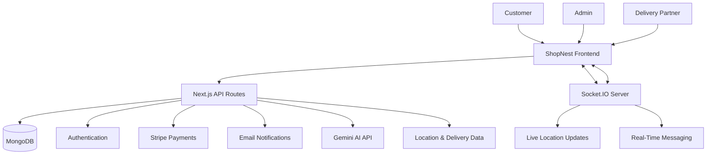

<div align="center">

# 🛒 ShopNest

### Your Smart Grocery Shopping & Delivery Platform

**Shop smarter. Track faster. Deliver better.**

A full-stack grocery delivery application featuring AI-powered assistance, interactive maps, real-time delivery tracking, secure authentication, and live communication between customers and delivery partners.

<br/>

<a href="https://shopnest-india.vercel.app">
  
</a>
<a href="https://github.com/samarthpandey158/groceryFolder">
  
</a>

<br/><br/>


</div>

---

## 📌 About the Project

**ShopNest** is a full-stack grocery shopping and delivery platform designed to simplify online grocery ordering and delivery management.

Customers can explore groceries, place orders, select their delivery location, communicate in real time, and track their deliveries. Administrators can manage grocery products and orders, while delivery partners can access assigned deliveries and share their location.

The application combines modern web technologies with AI integration, geolocation, and real-time communication to create a complete shopping and delivery experience.

## ✨ Key Features

<table>
<tr>
<td width="50%" valign="top">

### 🛍️ Grocery Shopping

* Browse available grocery products.
* Add products to the cart.
* Proceed through the checkout process.
* Place and manage orders.
* View order status and updates.

</td>
<td width="50%" valign="top">

### 🤖 AI Shopping Assistant

* AI-powered conversational assistance.
* Grocery-related queries and suggestions.
* Gemini API integration.
* Interactive chat experience.

</td>
</tr>
<tr>
<td width="50%" valign="top">

### 🗺️ Maps & Location

* Interactive maps using Leaflet.
* Map-based delivery address selection.
* Geolocation-based features.
* Delivery location visualization.

</td>
<td width="50%" valign="top">

### 🚚 Real-Time Delivery Tracking

* Delivery partner location updates.
* Real-time communication using Socket.IO.
* Order status tracking.
* Delivery assignment workflow.

</td>
</tr>
<tr>
<td width="50%" valign="top">

### 👨‍💼 Admin Dashboard

* Manage grocery products.
* Access order management features.
* Update order status.
* Support delivery management workflows.

</td>
<td width="50%" valign="top">

### 💬 Live Communication

* Real-time messaging.
* Socket.IO room-based communication.
* Customer and delivery-related communication.
* Order-linked messaging functionality.

</td>
</tr>
</table>

### 🔐 Authentication & Payments

* Credentials-based authentication.
* Google sign-in integration.
* Password hashing with bcrypt.
* Stripe payment integration.
* Email notifications and delivery OTP functionality.

---

## 🖥️ Technology Stack

| Category         | Technologies                |
| ---------------- | --------------------------- |
| Frontend         | Next.js, React, TypeScript  |
| Styling          | Tailwind CSS                |
| Backend          | Next.js API Routes, Node.js |
| Real-Time Server | Express.js, Socket.IO       |
| Database         | MongoDB, Mongoose           |
| Authentication   | NextAuth.js, Google OAuth   |
| State Management | Redux Toolkit               |
| AI Integration   | Google Gemini API           |
| Maps             | Leaflet, React Leaflet      |
| Payments         | Stripe                      |
| Email            | Nodemailer                  |
| Media Storage    | Cloudinary                  |
| HTTP Requests    | Axios                       |
| Icons            | Lucide React, React Icons   |

---

## 🏗️ System Architecture



### How It Works

1. Customers browse products and add items to their cart.
2. Customers select their delivery address and place an order.
3. The backend processes order data and stores relevant information in MongoDB.
4. Administrators manage products and order workflows.
5. Delivery partners receive delivery assignments and update their location.
6. Socket.IO supports real-time messaging and location updates.
7. Gemini AI provides conversational assistance.
8. Email functionality supports notifications and delivery verification workflows.

---

## 🗺️ AI & Real-Time Location: What Makes ShopNest Different?

### 🤖 AI-Powered Assistance

ShopNest integrates the Google Gemini API to provide an AI-powered conversational experience.

**Why it matters:**

* Demonstrates integration with a generative AI API.
* Adds an interactive assistance layer to the shopping experience.
* Shows experience working with API keys and external AI services.

### 📍 Interactive Maps

Leaflet and React Leaflet provide map-based functionality for location-related features.

**Why it matters:**

* Supports visual address selection and location display.
* Demonstrates integration of mapping libraries into a full-stack application.
* Provides a foundation for location-aware delivery workflows.

### 🚚 Real-Time Delivery Updates

Socket.IO enables real-time communication between the frontend and the separate socket server.

**Why it matters:**

* Supports live location updates.
* Enables real-time messaging.
* Demonstrates event-driven communication between application components.

> **Note:** Live tracking depends on the availability of the socket server, location permissions, and the configured environment variables.

---

## 📁 Project Structure

The repository contains the main application and a separate socket server.

```text
groceryFolder/
│
├── shopnest/
│   ├── public/
│   ├── src/
│   │   ├── app/
│   │   │   └── api/
│   │   ├── components/
│   │   ├── lib/
│   │   ├── models/
│   │   ├── hooks/
│   │   └── ...
│   ├── package.json
│   └── ...
│
├── socketServer/
│   ├── index.js
│   ├── package.json
│   └── ...
│
└── README.md
```

*Note: The structure above is a high-level overview. Some folders and files may differ in your actual repository.*

---

## ⚙️ Getting Started

Follow these steps to run ShopNest locally.

### Prerequisites

Install the following:

* [Node.js](https://nodejs.org/)
* npm
* MongoDB database or a MongoDB Atlas connection
* Git

API credentials are required for the third-party services you want to use.

### 1. Clone the Repository

```bash
git clone https://github.com/samarthpandey158/groceryFolder.git
```

```bash
cd groceryFolder
```

### 2. Install Frontend Dependencies

```bash
cd shopnest
npm install
```

### 3. Configure Environment Variables

Create a `.env.local` file inside the `shopnest` directory.

Add the environment variables required by your implementation:

```env
MONGODB_URL=your_mongodb_connection_string

AUTH_SECRET=your_auth_secret

GOOGLE_CLIENT_ID=your_google_client_id
GOOGLE_CLIENT_SECRET=your_google_client_secret

GEMINI_API_KEY=your_gemini_api_key

STRIPE_SECRET_KEY=your_stripe_secret_key
STRIPE_WEBHOOK_SECRET=your_stripe_webhook_secret

EMAIL=your_email
PASS=your_email_app_password

CLOUDINARY_NAME=your_cloudinary_name
CLOUDINARY_API_KEY=your_cloudinary_api_key
CLOUDINARY_API_SECRET=your_cloudinary_api_secret

NEXT_BASE_URL=http://localhost:3000

NEXT_PUBLIC_SOCKET_SERVER=http://localhost:5000
```

**Important:**

* Use the exact environment variable names referenced by your source code.
* If your implementation uses a different Socket.IO URL variable, configure that name instead.
* Some variables are only required for the corresponding features.
* Configure the correct Google OAuth redirect URLs and Stripe webhook endpoint.
* Never commit real credentials or secret keys to GitHub.

### 4. Start the Frontend

From the `shopnest` directory:

```bash
npm run dev
```

Open:

```text
http://localhost:3000
```

### 5. Start the Socket.IO Server

Open a separate terminal:

```bash
cd socketServer
npm install
```

Configure the socket server's environment variables according to its source code. For example:

```env
PORT=5000
NEXT_BASE_URL=http://localhost:3000
```

Start the socket server using the script defined in its `package.json`. If the project uses a `dev` script:

```bash
npm run dev
```

The frontend and socket server must both be running for local real-time features to work.

---

## 🌐 Live Demo

Try the deployed application:

<div align="center">

### 🛒 Experience ShopNest

<a href="https://shopnest-india.vercel.app">
  
</a>

</div>

**Live URL:** https://shopnest-india.vercel.app

Some features may depend on the availability of external services, database connectivity, authentication configuration, and the deployed socket server.

---

## 🔒 Security Considerations

* Keep API keys and database credentials in environment variables.
* Never expose private API keys through `NEXT_PUBLIC_` variables.
* Validate and authorize requests on the server.
* Hash passwords before storing them.
* Configure OAuth redirect URLs correctly.
* Verify payment webhooks before trusting payment events.
* Protect admin and delivery-partner routes with appropriate authorization.
* Avoid committing `.env` or `.env.local` files.

---

## 🚀 Future Improvements

Potential enhancements include:

* [ ] Improve AI-assisted product discovery.
* [ ] Add advanced grocery search and filtering.
* [ ] Improve live tracking reliability and location update handling.
* [ ] Add delivery time estimates.
* [ ] Expand analytics for administrators.
* [ ] Improve automated testing and error monitoring.
* [ ] Enhance accessibility and mobile responsiveness.
* [ ] Add more comprehensive order and payment reporting.

---

## 🎯 Project Highlights

ShopNest demonstrates practical experience with:

* Full-stack application development.
* REST API development and database integration.
* Authentication and authorization.
* Third-party AI API integration.
* Geolocation and interactive maps.
* Real-time communication using WebSockets through Socket.IO.
* Payment and email service integration.
* Role-based application workflows.
* Deployment and environment configuration.

These capabilities make ShopNest a useful project for demonstrating full-stack development skills in internship and entry-level software engineering applications.

---

## 👨‍💻 Author

**Samarth Pandey**

Computer Science & Engineering Student | Full-Stack Developer

* **GitHub:** [@samarthpandey158](https://github.com/samarthpandey158)
* **Project Repository:** [groceryFolder](https://github.com/samarthpandey158/groceryFolder)
* **Live Demo:** [ShopNest](https://shopnest-india.vercel.app)

---

<div align="center">

### ⭐ If you find ShopNest interesting, consider starring the repository!

**Built with ❤️ and modern web technologies.**

</div>
