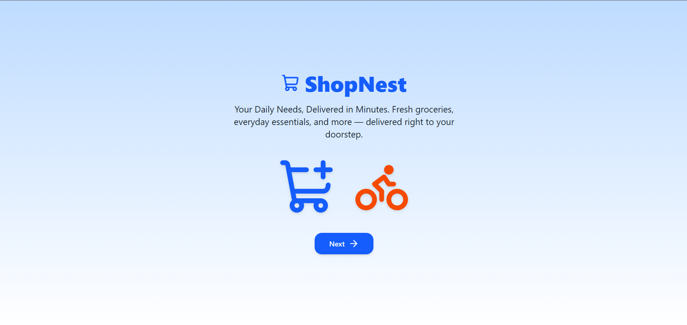
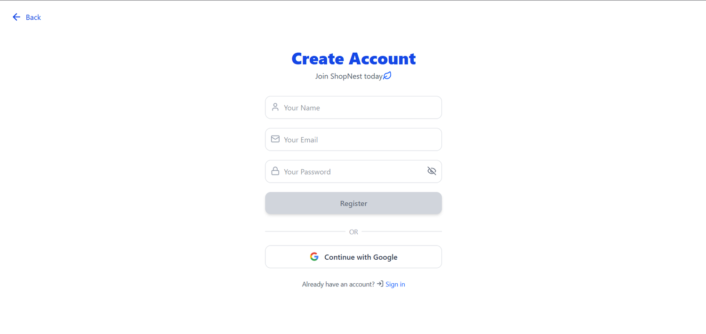
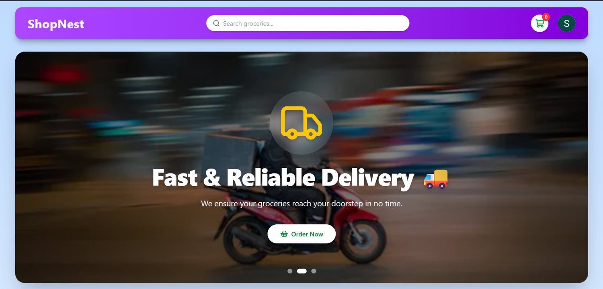
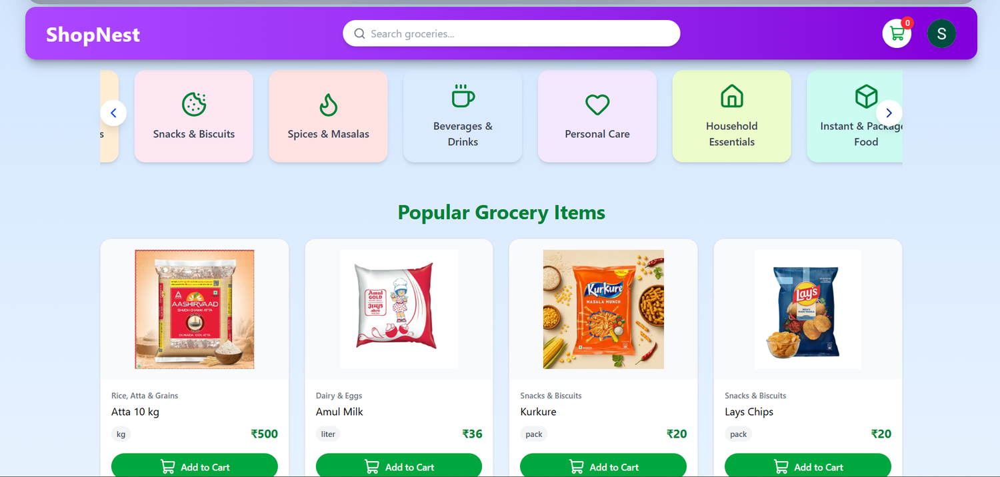
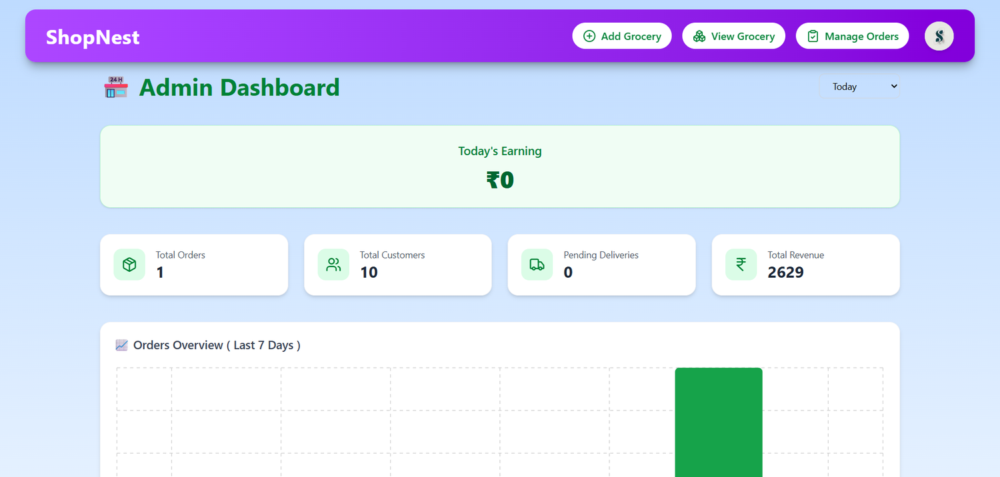
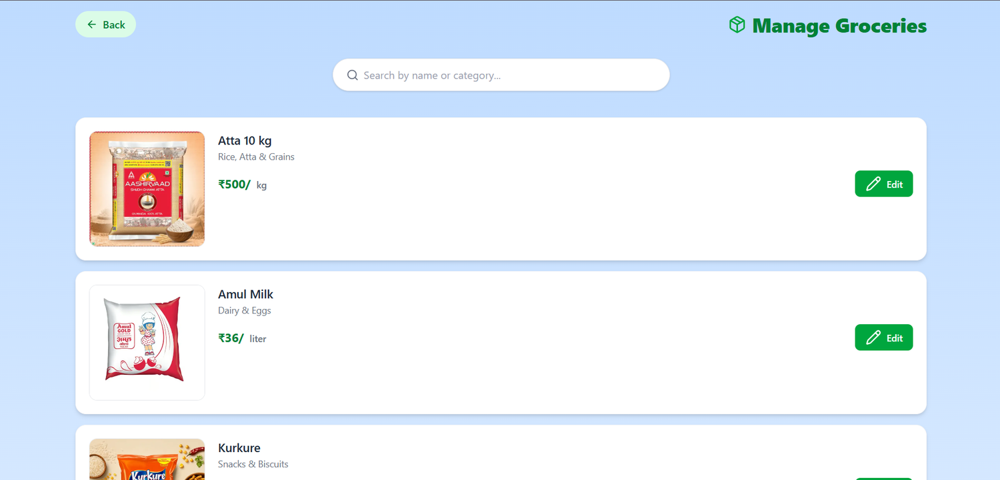
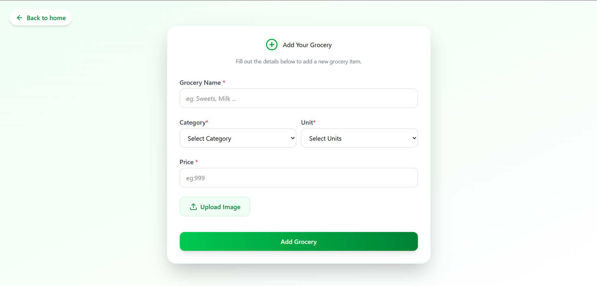
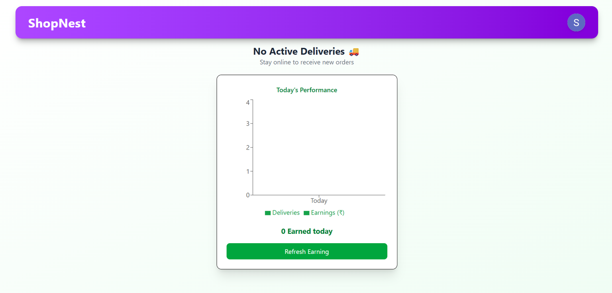
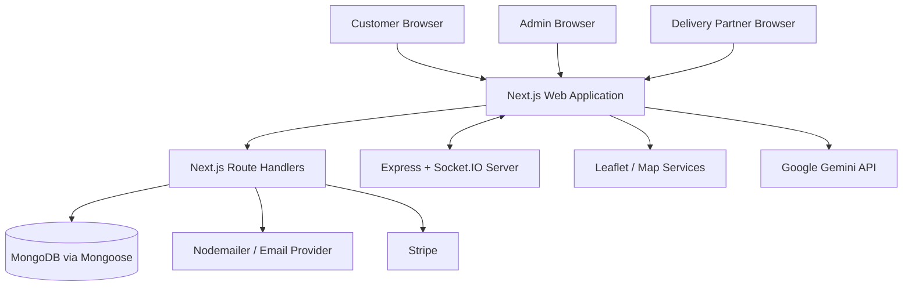

<div align="center">

# 🛒 ShopNest — Smart Grocery Delivery Platform

**A full-stack grocery shopping and delivery application with role-based dashboards, order management, live delivery tracking, real-time communication, and AI-assisted support.**

<p>
  <a href="https://github.com/samarthpandey158/groceryFolder"><strong>GitHub Repository</strong></a>
  &nbsp;•&nbsp;
  <a href="https://shopnest-brown.vercel.app/">Live Demo</a>
</p>

</div>

---

## 📌 Overview

**ShopNest** is a full-stack grocery delivery web application designed to bring the complete grocery ordering journey into one place. Customers can browse grocery items, manage their cart, place orders, and follow order progress. Administrators can manage grocery inventory and orders, while delivery partners can handle assigned deliveries and share location updates.

The project combines a customer-facing shopping experience with administrative and delivery workflows. It also includes real-time communication, map-based location features, email OTP verification for delivery completion, online payment support, and an AI chat experience.

> **Portfolio note:** Replace `YOUR_DEPLOYED_APP_URL` with the public deployment URL before publishing. If the live demo is not available, remove the Live Demo link.

## ✨ Key Features

### 🛍️ Customer Experience
- Account registration and sign-in, including Google sign-in.
- Browse grocery products by category and search for items.
- Add products to the cart and adjust quantities.
- Review the cart and order summary before checkout.
- Place orders using the supported payment options: Cash on Delivery (COD) and Stripe, where configured.
- View order information and follow order progress.
- Select a delivery location using map-based functionality.
- Access an AI-powered chat experience.

### 🧑‍💼 Admin Dashboard
- Dedicated admin dashboard.
- Add and manage grocery products, including product images, categories, units, and prices.
- Review grocery inventory and order information.
- Manage order workflow and assign deliveries, according to the implemented admin flow.
- View dashboard summaries and order-related information.

### 🛵 Delivery Partner
- Dedicated delivery-partner dashboard.
- View delivery assignments and update delivery progress.
- Share location updates for live tracking, when connected.
- Use order communication features where enabled.
- Complete the delivery verification flow using email OTP.

### ⚡ Real-Time and Integrations
- Socket.IO-powered real-time updates and communication.
- Map-based location selection and delivery tracking.
- Email delivery for OTP/transactional messages, subject to mail-provider configuration.
- Stripe integration for online payments, subject to valid keys and webhook configuration.
- Gemini API integration for AI chat functionality.

## 🧰 Technology Stack

| Area | Technologies |
| --- | --- |
| Web application | Next.js, React, TypeScript |
| Styling and UI | Tailwind CSS and project UI components |
| Server/API | Next.js Route Handlers |
| Database | MongoDB, Mongoose |
| Authentication | NextAuth.js, Credentials and Google providers |
| Real-time communication | Socket.IO, separate Node.js/Express socket server |
| Maps and location | Leaflet and location services |
| Payments | Stripe and Cash on Delivery |
| Email | Nodemailer |
| AI | Google Gemini API |
| Deployment | Vercel for the web app; deploy the socket server separately |

*The table reflects the technologies used or discussed in this project. Features that depend on third-party services require their respective environment variables and provider configuration.*

## 🖼️ Application Screenshots

Screenshots below use image files stored in the **repository root**. Keep the filenames identical to the paths shown here, or update the paths if you move images into a folder.

### 1. Welcome Screen


### 2. Customer Sign In


### 3. Customer Registration


### 4. Customer Homepage


### 5. Grocery Catalogue


### 6. Shopping Cart


### 7. Admin Dashboard


### 8. Manage Groceries


### 9. Add Grocery Form


### 10. Grocery Added Successfully


### 11. Delivery Partner Dashboard


### 12. Delivery OTP Verification


> **Screenshot setup:** The existing repository screenshot names include `customer-homepage.png`, `grocery-catalogue.png`, `customer-sign-in.png`, `customer-registration.png`, `admin-dashboard.png`, `admin-manage-groceries.png`, `admin-add-grocery.png`, and `delivery-partner-dashboard.png`. For the additional screenshots above, upload the matching image files to the repository root with the exact names `welcome-screen.png`, `shopping-cart.png`, `grocery-added-successfully.png`, and `otp-verification.png`. If you do not want to add those extra files, remove their screenshot sections or change the paths to match your actual filenames.

## 🏗️ Application Architecture



## 📂 Repository Structure

The repository contains the Next.js application and a separate Socket.IO server. The following is a high-level illustration; actual file names may differ as the project evolves.

```text
groceryFolder/
├── shopnest/       # Next.js application
│   ├── src/
│   │   ├── app/    # Pages and API route handlers
│   │   ├── components/
│   │   ├── lib/
│   │   └── models/
│   ├── public/
│   ├── package.json
│   └── ...
├── socketServer/   # Express and Socket.IO server
│   ├── package.json
│   └── ...
├── README.md
└── *.png           # Repository screenshots (if kept in the root)
```

## 🚀 Getting Started

### Prerequisites
- Node.js and npm compatible with the project's dependencies.
- A MongoDB database.
- Credentials for any integrations you want to enable (Google OAuth, Stripe, email, Gemini).
- A separately running/deployed Socket.IO server for real-time features.

### 1. Clone the repository

```bash
git clone https://github.com/samarthpandey158/groceryFolder.git
cd groceryFolder
```

### 2. Install the web application dependencies

Open the Next.js application directory. In this repository it is expected to be `shopnest/`:

```bash
cd shopnest
npm install
```

### 3. Configure environment variables

Create a `.env.local` file in the Next.js app directory and use the variable names expected by your code. **Do not commit real secrets.**

Typical configuration categories include:

```env
# Database
MONGODB_URI=

# Authentication
NEXTAUTH_SECRET=
NEXTAUTH_URL=

# Google OAuth
GOOGLE_CLIENT_ID=
GOOGLE_CLIENT_SECRET=

# Stripe
STRIPE_SECRET_KEY=
STRIPE_WEBHOOK_SECRET=

# Email / Nodemailer
EMAIL=
PASS=

# Google Gemini
GEMINI_API_KEY=

# Socket server URL — use the variable name referenced by your app
NEXT_PUBLIC_SOCKET_URL=
```

These are illustrative placeholders, not a guarantee that every variable name matches your source code. Check your `.env` usage in the project and keep the names consistent with your implementation. Do not publish API keys, passwords, database connection strings, or webhook secrets.

### 4. Run the Next.js application

```bash
npm run dev
```

Open the local URL printed in the terminal (typically `http://localhost:3000`).

### 5. Run the Socket.IO server

Open a second terminal and run:

```bash
cd socketServer
npm install
npm run
```

Check `socketServer/package.json` for the actual available start/development script, then run that script (for example, `npm run dev` or `npm start` if defined).

## 🔐 Security and Deployment Notes

- Keep `.env.local` and all secrets out of Git.
- Configure production environment variables in the hosting platform.
- Configure Google OAuth redirect URLs for the deployed domain.
- Configure Stripe webhooks using the deployed webhook endpoint.
- Use an email provider configuration suitable for production and test delivery to inboxes.
- Deploy the Socket.IO server separately if the hosting setup does not support the required persistent WebSocket connections.
- Validate authorization and role permissions on the server, not only in the UI.
- Do not expose private keys or server-only environment variables with a `NEXT_PUBLIC_` prefix.
- Test checkout, OTP delivery, live tracking, and real-time messaging in the deployed environment before presenting them as production-ready.

## 🧪 Suggested Portfolio Demo Flow

1. Register or sign in as a customer.
2. Browse the catalogue and add grocery items to the cart.
3. Review the cart and place a test/COD order.
4. Open the admin dashboard and manage products or the order workflow.
5. Assign the order to a delivery partner.
6. Demonstrate delivery status updates and map-based location tracking.
7. Show the OTP verification flow and AI chat feature.

Use test accounts and test payment credentials during demonstrations. Do not include private credentials in the README.

## 🎯 What This Project Demonstrates

- Full-stack application development with Next.js and TypeScript.
- Data modelling and persistence with MongoDB and Mongoose.
- Authentication and role-based application flows.
- API route implementation and third-party service integration.
- Real-time features using Socket.IO.
- Map-based UI and delivery workflow design.
- Payment and email integration.
- Admin/customer/delivery-partner workflows in one application.

## 👨‍💻 Author

**Samarth Pandey**  
GitHub: [@samarthpandey158](https://github.com/samarthpandey158)

---

<div align="center">
  <sub>Built as a full-stack grocery delivery project. Please check the repository for the current implementation and setup requirements.</sub>
</div>
