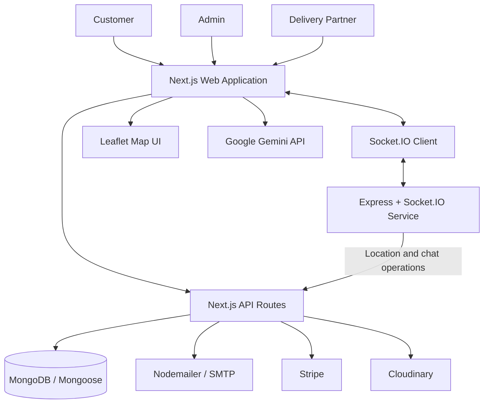

<div align="center">

# 🛒 ShopNest
### Smart Grocery Delivery Platform

**Shop smarter. Track deliveries live. Get AI-powered assistance.**

A full-stack grocery delivery platform built with **Next.js, MongoDB, Socket.IO, AI, and interactive maps**.

<br/>

[](https://shopnest-india.vercel.app)
[](https://github.com/samarthpandey158/groceryFolder)
[](https://nextjs.org/)
[](https://www.mongodb.com/)
[](https://socket.io/)

</div>

<p align="center">
  <b>🤖 Gemini AI</b> &nbsp; • &nbsp; <b>🗺️ Map-Based Location</b> &nbsp; • &nbsp; <b>📍 Live Delivery Updates</b> &nbsp; • &nbsp; <b>🔐 Role-Based Access</b>
</p>

---

## 🧭 Table of Contents

- [Overview](#overview)
- [Live Demo](#live-demo)
- [Features](#features)
- [AI Chat Experience](#ai-chat-experience)
- [Maps and Live Delivery Tracking](#maps-and-live-delivery-tracking)
- [Technology Stack](#technology-stack)
- [Architecture](#architecture)
- [Project Structure](#project-structure)
- [Run Locally](#run-locally)
- [Environment Variables](#environment-variables)
- [Data Models](#data-models)
- [Order Workflow](#order-workflow)
- [Deployment Notes](#deployment-notes)
- [Security Considerations](#security-considerations)
- [Author](#author)

## ✨ Overview

**ShopNest** is a full-stack grocery shopping and delivery platform designed around three roles: **Customer, Admin, and Delivery Partner**. Customers can browse grocery products, manage a cart, place orders, and follow delivery progress. Administrators can manage grocery listings and order workflows. Delivery partners can view assigned deliveries, update order progress, and share their location for tracking.

The application combines a Next.js web application with a separate Express and Socket.IO service. It integrates database-backed order management, authentication, AI-assisted chat, map-based location features, real-time communication, email OTP verification, and payment/media services.

## 🌐 Live Demo

- **Web application:** [https://shopnest-india.vercel.app](https://shopnest-brown.vercel.app)
- **Source code:** [GitHub — groceryFolder](https://github.com/samarthpandey158/groceryFolder)

The web app is deployed on **Vercel**. Real-time location and messaging also depend on the separately deployed Socket.IO service and its configuration. Availability of third-party features depends on their credentials and service status.

> **Tip:** If you are reviewing this project for an internship or collaboration, start with the live demo, then explore the AI chat and map-based delivery flow.

## 🚀 Features

### 🛍️ Customer
- Register and sign in using the authentication providers configured in the application.
- Browse grocery products and categories.
- Search for products and manage cart quantities.
- Review cart details and proceed to checkout.
- Place orders using Cash on Delivery (COD) or the configured Stripe payment flow.
- View order details and follow order status.
- Choose a delivery location using the map interface.
- Track delivery progress and location updates when the real-time service is connected.
- Use the AI-assisted chat experience.

### 🧑‍💼 Admin
- Access a dedicated admin dashboard.
- Add and manage grocery products and listing details.
- Review grocery inventory and order information.
- Manage order progress and delivery assignments through the admin workflow.

### 🛵 Delivery Partner
- Access a dedicated delivery-partner dashboard.
- View assigned deliveries.
- Update delivery progress.
- Share location updates for live tracking when connected.
- Complete delivery verification through the email OTP workflow.

### ⚡ Real-Time Communication & Integrations
- Socket.IO events for real-time updates.
- Order-associated chat between relevant participants.
- Leaflet-based map interface and location functionality.
- Nodemailer/SMTP for email OTP and transactional messages.
- Stripe for online payments, when correctly configured.
- Cloudinary for media handling.
- Google Gemini API for AI-assisted chat functionality.

## 🤖 AI Chat Experience

ShopNest integrates the **Google Gemini API** to provide an AI-assisted chat experience within the grocery application.

The AI feature adds an interactive assistance layer to the shopping experience, rather than limiting the platform to static product listings and checkout screens. It can support user-facing chat or suggestions according to the prompts and flows implemented in the application.

**Implementation note:** AI responses depend on the configured Gemini API key, network availability, provider limits, and the code's prompt/response handling. Do not present AI output as guaranteed, always correct, or a substitute for official order or payment status.

## 🗺️ Maps & Live Delivery Tracking

ShopNest includes a **Leaflet-based map interface** and location functionality to support delivery-location selection and order tracking.

The map and real-time flow are designed to connect the customer experience with delivery-partner location updates:

1. A delivery location can be selected through the map-based interface.
2. The delivery partner's client can send coordinate updates to the Socket.IO service.
3. The real-time service broadcasts location events to connected clients and can call the Next.js API for related application operations.
4. The customer-facing interface can display delivery progress and location updates while the relevant services are online.

This is a combination of **geospatial UI and real-time event communication**: Leaflet renders the map interface, while Socket.IO carries live events. The accuracy and freshness of tracking depend on device location permissions, connectivity, update frequency, and the deployed socket service.

## 🧰 Technology Stack

| Category | Technologies |
|---|---|
| Web framework | Next.js App Router, React, TypeScript |
| Styling and UI | Tailwind CSS, Lucide React, React Icons, Motion |
| Client state | Redux Toolkit, React Redux |
| Authentication | NextAuth, Credentials provider, Google provider, bcrypt |
| Database | MongoDB |
| Data modelling | Mongoose |
| Real-time communication | Socket.IO client, Socket.IO |
| Socket server | Node.js, Express |
| Maps and location UI | Leaflet, React Leaflet, Leaflet GeoSearch |
| HTTP requests | Axios |
| Email | Nodemailer with SMTP |
| Media | Cloudinary |
| Payments | Stripe and Cash on Delivery |
| AI | Google Gemini API |
| Code quality | ESLint |
| Web deployment | Vercel; Socket.IO service deployed separately |

## 🏗️ Architecture



The Next.js application handles the UI, authentication, application APIs, and database operations. The separate Socket.IO service manages persistent real-time connections and emits events to connected clients. The AI, map, email, payment, and media integrations provide additional capabilities around the core grocery-ordering workflow.

## 📁 Project Structure

```text
groceryFolder/
├── shopnest/                  # Next.js web application
│   ├── src/
│   │   ├── app/               # Pages, layouts, and API route handlers
│   │   ├── components/         # Customer, admin, delivery, map, and chat UI
│   │   ├── lib/                # Database, email, media, and socket utilities
│   │   ├── models/             # Mongoose models
│   │   └── redux/              # Redux store and slices
│   ├── public/                 # Static assets
│   ├── package.json
│   └── next.config.ts
├── socketServer/               # Express + Socket.IO service
│   ├── index.js
│   └── package.json
└── README.md
```

This is a high-level overview of the repository; exact subdirectories may change as the project evolves.

## ⚙️ Run Locally

### Prerequisites
- Node.js and npm compatible with the dependencies declared in the project's `package.json` files.
- A MongoDB database (local or hosted).
- Google OAuth credentials if Google sign-in is enabled.
- SMTP credentials if email delivery is enabled.
- Stripe credentials if online payments are enabled.
- Cloudinary and Gemini credentials for the corresponding integrations.
- A host capable of maintaining Socket.IO connections for the real-time service.

### 1. Clone the repository

```bash
git clone https://github.com/samarthpandey158/groceryFolder.git
cd groceryFolder
```

### 2. Install the web application dependencies

```bash
cd shopnest
npm install
```

Create `shopnest/.env.local` and configure the variables used by your current code.

### 3. Install the Socket.IO service dependencies

Open a second terminal from the repository root:

```bash
cd socketServer
npm install
```

Create `socketServer/.env` and configure the socket service.

### 4. Start both services

**Terminal 1 — Next.js web application**

```bash
cd shopnest
npm run dev
```

The web app normally starts at `http://localhost:3000`.

**Terminal 2 — Socket.IO service**

```bash
cd socketServer
npm run dev
```

Check `socketServer/package.json` for the exact script name if it differs in your local checkout. Both services must be running to test real-time features locally.

## 🔑 Environment Variables

The following variable names are based on project documentation and code references available for this repository. **Confirm names against the current source before deploying. Never commit real credentials.**

### `shopnest/.env.local`

```env
# MongoDB
MONGODB_URL=

# Authentication
AUTH_SECRET=

# Google OAuth
GOOGLE_CLIENT_ID=
GOOGLE_CLIENT_SECRET=

# Socket.IO URL used by the frontend
NEXT_PUBLIC_SOCKET_SERVER=http://localhost:5000

# Nodemailer / SMTP
EMAIL=
PASS=

# Stripe
STRIPE_SECRET_KEY=
STRIPE_WEBHOOK_SECRET=

# Cloudinary
CLOUDINARY_NAME=
CLOUDINARY_API_KEY=
CLOUDINARY_API_SECERT=

# Google Gemini
GEMINI_API_KEY=

# Base URL used by application/payment flows
NEXT_BASE_URL=http://localhost:3000
```

### `socketServer/.env`

```env
PORT=5000
NEXT_BASE_URL=http://localhost:3000
```

**Configuration notes**
- `MONGODB_URL` is the MongoDB connection string.
- `AUTH_SECRET` is used for authentication/session security.
- `GOOGLE_CLIENT_ID` and `GOOGLE_CLIENT_SECRET` configure Google OAuth.
- `NEXT_PUBLIC_SOCKET_SERVER` should point to the Socket.IO server. Confirm that the frontend uses this exact variable name.
- `EMAIL` and `PASS` are used by Nodemailer. If using Gmail, use an App Password where required.
- `STRIPE_SECRET_KEY` and `STRIPE_WEBHOOK_SECRET` are used by the Stripe integration and webhook flow.
- The current Cloudinary variable reference spells the secret as `CLOUDINARY_API_SECERT`. This appears to be a typo; consider correcting it consistently in the code and environment configuration before production use.
- `GEMINI_API_KEY` is used by the Gemini integration.
- `NEXT_BASE_URL` should point to the web application's base URL. Use the deployed URL in production.
- Configure Socket.IO CORS to allow only the intended frontend origin.

## 🗃️ Data Models

The application includes Mongoose models for the following entities:

| Model | Responsibility |
|---|---|
| `User` | Account/profile details, role, online status, socket ID, and location |
| `Grocery` | Product information such as name, category, price, unit, and image |
| `Order` | Customer, items, total, payment method/status, delivery address, OTP, and order status |
| `DeliveryAssignment` | Delivery assignment and delivery-partner workflow |
| `Message` | Messages associated with an order room |

The user location uses a GeoJSON-style field with a `2dsphere` index for geospatial functionality.

## 🔄 Order Workflow

1. A customer signs in, browses groceries, and adds items to the cart.
2. The customer proceeds to checkout and selects an available payment method.
3. The order is stored and becomes available to the admin workflow.
4. The admin manages the order and assigns a delivery partner.
5. The delivery partner updates delivery progress and shares location updates.
6. The customer can follow order progress and map-based location updates while real-time services are connected.
7. Relevant participants can exchange messages through the order chat where enabled.
8. Delivery completion can be verified through the email OTP workflow.

Payment completion, email delivery, and live tracking depend on correct credentials, provider configuration, authorization, and deployment settings.

## 🚀 Deployment Notes

The web application is deployed on Vercel. The real-time Socket.IO service is hosted separately, so both deployments must be correctly configured for live location and chat features.

Before sharing the demo:
- Verify the public web app opens and key customer flows work.
- Confirm the deployed Socket.IO URL is configured in the Vercel environment variables.
- Confirm the socket server allows requests from the deployed web-app origin.
- Test Google OAuth redirect URLs, email OTP delivery, and Stripe webhook configuration if those integrations are enabled.
- Test AI chat and map tracking in the deployed environment, not only on localhost.

## 🛡️ Security Considerations

- Never commit `.env`, `.env.local`, database credentials, API keys, OAuth secrets, SMTP passwords, or payment secrets.
- Keep server-only secrets out of variables prefixed with `NEXT_PUBLIC_`.
- Enforce role and order-ownership checks in server-side API routes.
- Validate request bodies and Socket.IO event payloads.
- Verify payment status using trusted server-side provider/webhook events.
- Restrict internal notification endpoints and order-room access.
- If a secret was committed, rotate or revoke it; removing it from the latest commit is not sufficient.

## 👨‍💻 Author

**Samarth Pandey**

- GitHub: [@samarthpandey158](https://github.com/samarthpandey158)
- Project repository: [groceryFolder](https://github.com/samarthpandey158/groceryFolder)

---

<div align="center">
  <sub>ShopNest — Full-stack grocery shopping and delivery application.</sub>
</div>
